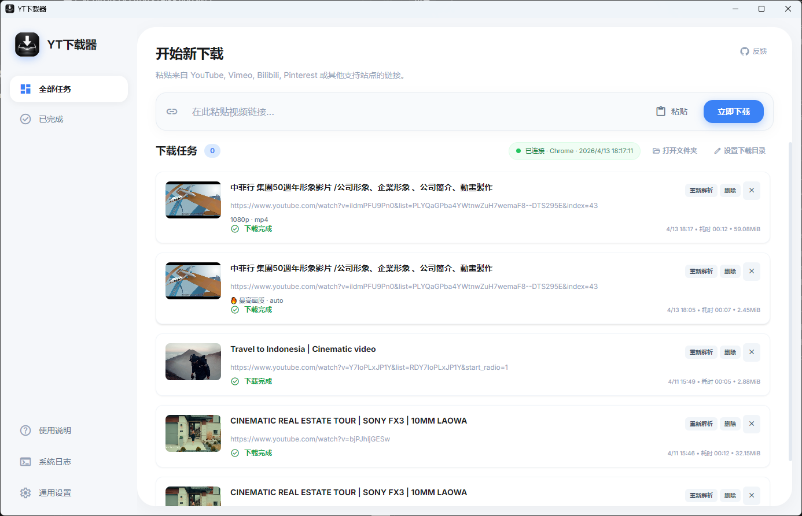
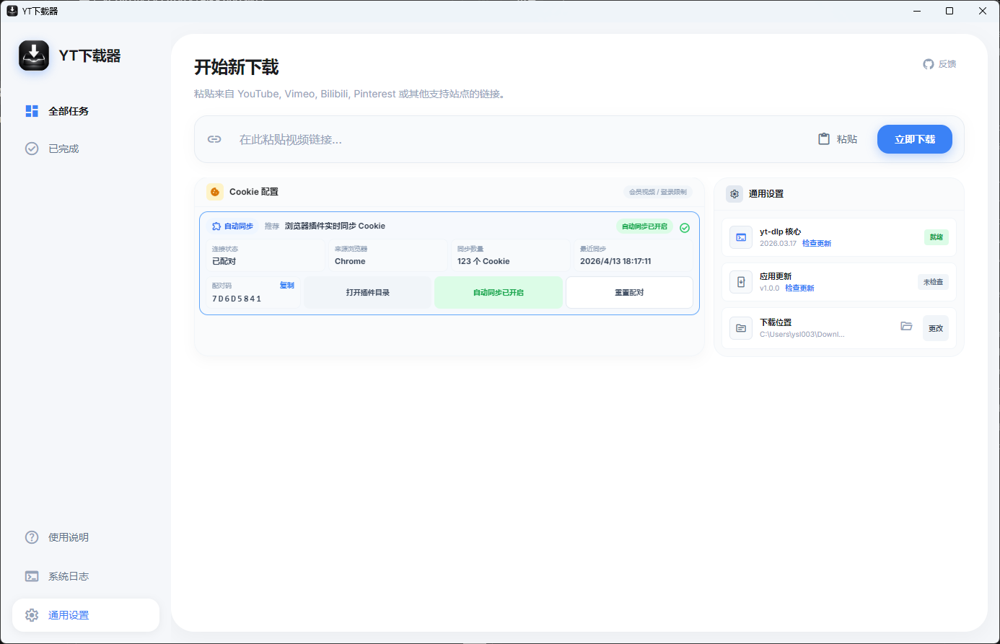
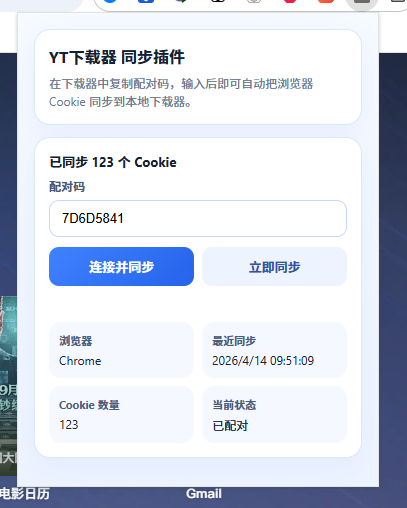

# YT下载器

基于 `yt-dlp + Electron` 的桌面视频下载工具，支持常见视频网站解析、清晰度选择下载、浏览器插件自动同步 Cookie、GitHub 更新检查等功能。

## 功能特性

- 支持常见视频网站视频解析与下载
- 解析后可手动选择清晰度再开始下载
- 会员/登录视频通过浏览器插件自动同步 Cookie
- 取消下载后保留解析结果，可直接切换其他清晰度继续下载
- 1080p 及以下优先输出为 `mp4`，更高分辨率使用 `mkv`
- 支持 Artlist 歌曲页面下载站点试听音频（AAC）
- 支持 GitHub Release 检查更新

## 界面预览

### 首页



### 插件同步状态



### 任务列表



## 使用教程

### 1. 安装浏览器插件并配对

说明：当前只有浏览器插件这一种 Cookie 同步方式，不再需要手动导出或导入 Cookie 文件。

1. 打开软件，进入 `通用设置`
2. 点击 `打开插件目录`
3. 在 Chrome / Edge 的扩展管理页中开启开发者模式
4. 选择 `加载已解压的扩展程序`
5. 在插件中输入软件里显示的配对码
6. 配对成功后，插件会自动同步 Cookie

### 2. 粘贴视频链接

1. 将视频链接粘贴到首页输入框
2. 点击 `立即下载`
3. 软件会先解析视频信息和可用清晰度

### 3. 选择清晰度并下载

1. 在任务卡中选择需要的清晰度
2. 点击 `开始下载`
3. 下载完成后，任务卡会显示本次下载的分辨率和格式

Artlist 链接会显示唯一的 `Artlist 试听音频 (aac)` 选项。该功能只下载页面提供的试听音频，请确保你拥有相应的合法使用权。

### 4. 中途取消与重新选择清晰度

1. 下载中点击任务右侧 `X`
2. 软件会尝试终止下载并清理 `.part/.ytdl` 临时文件
3. 取消成功后，任务会保留在列表中
4. 你可以直接重新选择其他分辨率继续下载，无需重新粘贴链接

## 插件连不上时排查

1. 先确认 `YT下载器` 软件本体已经打开，并且没有被最小化退出
2. 在软件的 `系统日志` 中确认是否出现 `本地同步服务已启动: http://127.0.0.1:38491`
3. 如果没有这条日志，通常是软件未正常启动本地服务，或端口 `38491` 被别的程序占用
4. 如果主端口被占用，软件会自动切换到 `38492-38495` 里的备用端口，插件也会自动跟随尝试
5. 如果这些本地端口都无法正常通信，插件会自动把 Cookie 下载到系统下载目录下的 `YT下载器 Cookie Sync/browser_extension_cookies.txt`，软件会自动识别这个兜底文件
6. 如果仍失败，常见原因是本机安全软件、防火墙或浏览器安全策略拦截了插件访问本机地址，这时可尝试重启软件和浏览器，并临时关闭拦截类软件后重新配对

## 构建

```bash
npm install
npm run build
```

构建前会自动执行 `yt-dlp -U`，尽量保证安装包内置最新核心。
